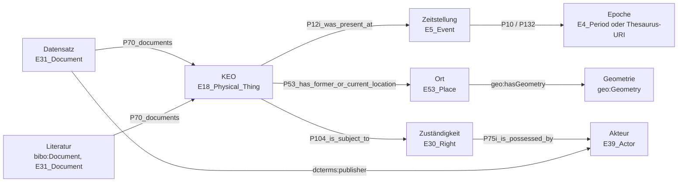

# Mapping des KEO-Austauschformats auf CIDOC CRM

Dieses Dokument legt fest, wie Datensätze nach dem Community-Standard für
Kulturerbeobjekte (KEO) in RDF nach CIDOC CRM überführt werden. Es setzt Teil D
„Eingang in den Knowledge Graph“ des Standards (Version 1.1 vom 25.11.2026) um
und ergänzt die Regeln, die für eine automatische Konvertierung nötig sind.
Umgesetzt ist es in [`csv2rdf.py`](../csv2rdf.py).

Grundlagen:

- [CIDOC CRM 7.1.3](https://cidoc-crm.org/Version/version-7.1.3) in der
  offiziellen RDFS-Kodierung, Namensraum `http://www.cidoc-crm.org/cidoc-crm/`
- das [CIDOC-CRM-in-RDF-Anwendungsprofil](https://nfdi4objects.github.io/crm-rdf-ap)
  von NFDI4Objects (Entwurf vom 27.01.2025). Es ersetzt E55 Type durch
  SKOS-Konzepte, verlangt für Zeitangaben EDTF- oder XSD-Literale statt P81/P82
  und für Geometrien GeoSPARQL.
- [DCMI Metadata Terms](https://www.dublincore.org/specifications/dublin-core/dcmi-terms/)
  für die Verwaltungsangaben des Datensatzes, weil CIDOC CRM dafür keine
  passenden Eigenschaften hat
- [PROV-O](https://www.w3.org/TR/prov-o/) für den Zeitpunkt des Datenexports

Ein LinkML-Schema ist für das Mapping nicht nötig. LinkML ordnet jedem Feld eine
einzelne Eigenschaft zu. Die meisten Felder brauchen in CIDOC CRM aber einen
Pfad über Zwischenknoten, etwa vom KEO über die Zeitstellung zur Epoche.

## Grundmodell

Das Mapping trennt zwei Ebenen. Das KEO selbst wird mit CIDOC CRM beschrieben.
Der Datensatz über das KEO ist ein eigener Knoten, der das KEO dokumentiert.
Zwischenknoten tragen Zeitstellung, Ort, Geometrie und Zuständigkeiten.



Bei translozierten KEO kommt eine Versetzung (E9_Move) hinzu, die den Ort als
Ziel oder Herkunft nennt.

**KEO als E18.** Der Standard lässt offen, ob ein KEO ein Bauwerk (E22), eine
Fundstelle (E27) oder eine Verdachtsfläche ist. E18_Physical_Thing ist die
gemeinsame Oberklasse und wird auch im Anwendungsprofil so verwendet. Die Werte
in `typ` differenzieren weiter.

**Zeitstellung als E5.** Epoche und absolute Datierung sagen nicht, worauf sie
sich beziehen. Gemeint sein kann die Entstehung, die Nutzung oder einfach das
Bestehen in dieser Zeit. Das Mapping hängt die Datierung deshalb an eine
datierte Phase (E5_Event), bei der das KEO zugegen war (P12i_was_present_at).
Laut CIDOC CRM legt P12 dabei ausdrücklich keine Rolle fest. Kennt eine Quelle
die Bedeutung, lässt sich das zu Entstehung (E63 mit P92i) oder Herstellung
(E12 mit P108i) verfeinern, denn beides sind Unterbegriffe. Abfragen über P12i
finden mit RDFS-Inferenz deshalb auch Daten, die über E12 datiert sind.

**Zuständigkeit als E30.** CIDOC CRM hat keine Eigenschaft für rechtliche
Zuständigkeit. Das Mapping versteht sie als Recht am Objekt (E30_Right), das
eine Behörde innehat. Fachbehörde und Genehmigungsbehörde bleiben über den Typ
des Rechts unterscheidbar.

**Datensatz getrennt.** PID, Zeitstempel und Lizenz beschreiben den Datensatz,
nicht das Denkmal. Er ist deshalb ein eigener Knoten, der das KEO über
P70_documents dokumentiert.

## Präfixe

| Präfix | Namensraum |
| --- | --- |
| `crm:` | `http://www.cidoc-crm.org/cidoc-crm/` |
| `geo:` | `http://www.opengis.net/ont/geosparql#` |
| `dcterms:` | `http://purl.org/dc/terms/` |
| `skos:` | `http://www.w3.org/2004/02/skos/core#` |
| `bibo:` | `http://purl.org/ontology/bibo/` |
| `edtf:` | `http://id.loc.gov/datatypes/edtf/` |
| `prov:` | `http://www.w3.org/ns/prov#` |
| `owl:`, `rdf:`, `rdfs:`, `xsd:` | W3C-Standardnamensräume |

## Feldweises Mapping

Jedes Feld hat genau einen Pfad. Eigenschaften ohne Präfix stammen aus CIDOC
CRM. „KEO“, „Ort“, „Geometrie“, „Zeitstellung“ und „Datensatz“ bezeichnen die
Knoten aus dem Grundmodell. `absolute_datierung` und `lagebezeichnung` sind
Metakonzepte ohne eigenen Knoten.

| Feld | Pfad | Anmerkung |
| --- | --- | --- |
| `pid` | Datensatz (E31_Document) | Eine http(s)-PID wird selbst zur IRI des Datensatzes. `hdl:`, `doi:` und `ark:` werden zur Resolver-IRI und zusätzlich als Kennung geführt. Andere PIDs erhalten eine IRI im eigenen Namensraum und eine Kennung. |
| `interne_id` | KEO → P1_is_identified_by → Kennung (rdf:value, Typ „Interne ID“) | Kennung des KEO, nicht des Datensatzes |
| `weitere_datenverknüpfung` | Wikidata, GND: KEO → owl:sameAs → Normdaten-URI. Sonst: KEO → P70i_is_documented_in → E31_Document | Wikidata-Seiten werden in Entitäts-URIs umgeschrieben. Portalseiten sind Dokumente über das KEO, nicht das KEO selbst. |
| `keo_bezeichnung` | KEO → skos:prefLabel | mit Sprachkennung |
| `beschreibung` | KEO → P67i_is_referred_to_by → E33_Linguistic_Object (Typ „Kurzbeschreibung“) → P190_has_symbolic_content | |
| `erweiterte_beschreibung` | wie `beschreibung`, Typ „Erweiterte Beschreibung“ | |
| `typ` | KEO → P2_has_type → skos:Concept | URI direkt, Freitext als lokales Konzept |
| `datierung` | KEO → P12i_was_present_at → Zeitstellung (E5_Event) | Metakonzept, wird zum Zwischenknoten. P12 lässt offen, ob Entstehung, Nutzung oder Bestehen gemeint ist. |
| `absolute_datierung_von`, `absolute_datierung_bis` | Zeitstellung → P4_has_time-span → EDTF-Literal | ein Ausdruck aus frühester und spätester Grenze, siehe [Datierung](#datierung) |
| `absolute_datierung_abgeleitet` | true: Zeitstellung → P2_has_type → „Absolute Datierung aus Epoche abgeleitet“ | false erzeugt keine Aussage |
| `epoche` | eine Epoche: Zeitstellung → P10_falls_within. Mehrere: Zeitstellung → P132_spatiotemporally_overlaps_with | Freitext wird E4_Period. P10 ist in CIDOC CRM Untereigenschaft von P132. |
| `weitere_datierungsinformationen` | Zeitstellung → P67i_is_referred_to_by → E33_Linguistic_Object (Typ „Weitere Datierungsinformationen“) | |
| `literatur` | bibo:Document und E31_Document → P70_documents → KEO, Zitat als rdfs:label | Enthält das Zitat eine DOI, wird sie zur IRI. |
| `obertägige_sichtbarkeit` | KEO → P2_has_type → „obertägig sichtbar“ oder „nicht obertägig sichtbar“ | |
| `vorschaubild` | KEO → P138i_has_representation → E36_Visual_Item | |
| `verweise` | KEO → P67i_is_referred_to_by → E73_Information_Object | Markdown-Linktext wird rdfs:label |
| `geometrie` | KEO → P53_has_former_or_current_location → Ort (E53_Place) → geo:hasGeometry → Geometrie (geo:Geometry) → geo:asWKT | P53 gilt für frühere und heutige Lage, passt also auch zu `translozierung` |
| `koordinatenbezugssystem` | KBS-IRI am Anfang des geo:wktLiteral | siehe [Geometrie und Achsenreihenfolge](#geometrie-und-achsenreihenfolge) |
| `lagegenauigkeit` | Geometrie → P2_has_type → Konzept (Schema Lagegenauigkeit) | geo:hasSpatialAccuracy erwartet eine Strecke, keinen Begriff |
| `datenerhebungsqualität` | Geometrie → P2_has_type → Konzept (Schema Datenerhebungsqualität) | |
| `translozierung` | true: KEO → P25i_moved_by → E9_Move, KEO zusätzlich E19_Physical_Object. false: KEO → P2_has_type → „nicht transloziert“ | P25 verlangt E19. Ein versetztes Objekt ist beweglich. |
| `transloziert_standort` | neuer Standort: E9_Move → P26_moved_to → Ort. Originalstandort: E9_Move → P27_moved_from → Ort | |
| `lagebezeichnung_adresse` | Ort → P1_is_identified_by → Kennung (Typ „Adresse“) | E45 Address gibt es seit CIDOC CRM 7 nicht mehr |
| `lagebezeichnung_ags` | Ort → P89_falls_within → Gebiet (E53_Place, IRI aus dem AGS) → P1_is_identified_by → Kennung (Typ „Amtlicher Gemeindeschlüssel“) | Gleicher AGS ergibt denselben Gebietsknoten |
| `lagebezeichnung_geonames` | Ort → P89_falls_within → `https://sws.geonames.org/<ID>/` | URL und ID werden vereinheitlicht |
| `lagebezeichnung_freitext` | Ort → P67i_is_referred_to_by → E33_Linguistic_Object (Typ „Lagebeschreibung“) | |
| `befundfrei` | KEO → P2_has_type → „befundfrei“ oder „nicht befundfrei“ | |
| `fachbehörde` | KEO → P104_is_subject_to → E30_Right (Typ „denkmalfachliche Zuständigkeit“) → P75i_is_possessed_by → Akteur | Zuständigkeit als Recht, siehe [Grundmodell](#grundmodell) |
| `genehmigungsbehörde` | wie `fachbehörde`, Typ „Genehmigungszuständigkeit“ | |
| `datenhaltende_institution` | Datensatz → dcterms:publisher → Akteur | stellt den Datensatz bereit |
| `datenhaltendes_system` | Datensatz → dcterms:source → System | |
| `letzte_änderung` | Datensatz → dcterms:modified | xsd:date oder xsd:dateTime je nach Angabe |
| `datenexport` | Datensatz → prov:generatedAtTime | Zeitpunkt, zu dem der exportierte Datensatz erzeugt wurde. dcterms:issued würde als Veröffentlichungsdatum gelesen. |
| `datenerstellung` | Datensatz → dcterms:created | wie `letzte_änderung` |
| `lizenz` | Datensatz → dcterms:license | CC-Kurznamen wie „CC BY 4.0“ und Links auf eine Sprachfassung wie `https://creativecommons.org/licenses/by/4.0/deed.de` werden zur Lizenz-URI `https://creativecommons.org/licenses/by/4.0/`. Andere URIs werden unverändert übernommen. Freitext wird zu einem dcterms:LicenseDocument mit dem Text als rdfs:label. |
| `zugriffsrecht` | Datensatz → dcterms:accessRights → Eintrag der EU-Normdatentabelle [Access right](https://op.europa.eu/en/web/eu-vocabularies/at-dataset/-/resource/dataset/access-right) | „öffentlich“ wird `…/access-right/PUBLIC`, „eingeschränkt“ wird `…/RESTRICTED`, „nicht öffentlich“ wird `…/NON_PUBLIC`, jeweils unter `http://publications.europa.eu/resource/authority/access-right/` |
| `urheber` | Datensatz → dcterms:creator → Akteur | |
| `bemerkung` | Datensatz → P67i_is_referred_to_by → E33_Linguistic_Object (Typ „Bemerkung zum Datensatz“) | |

Akteure (`fachbehörde`, `genehmigungsbehörde`, `datenhaltende_institution`,
`urheber`) werden nach ihrer URI typisiert: ROR wird E74_Group, ORCID wird
E21_Person, andere URIs werden E39_Actor. Namen ohne URI werden E39_Actor mit
einer IRI im eigenen Namensraum und skos:prefLabel.

## Werte und IRIs

### IRIs

Das KEO und seine Zwischenknoten hängen als Fragment an der IRI des
Datensatzes: `<Datensatz>#keo`, `#ort`, `#geometrie`, `#zeitstellung`,
`#translozierung`, `#fachzustaendigkeit` und `#genehmigungszustaendigkeit`.
Solange die PID gleich bleibt, behalten alle Knoten bei jedem neuen Export ihre
IRI. Kennungen und Freitexte sind leere Knoten, wie in den Beispielen des
Anwendungsprofils.

Lokal erzeugte IRIs liegen in einem einstellbaren Namensraum `<basis>`, bis zur
Festlegung `https://example.org/keo/`:

| Was | IRI |
| --- | --- |
| Datensatz ohne http(s)-PID | `<basis>datensatz/<PID>` |
| Akteur ohne URI | `<basis>akteur/<Name>` |
| Datenhaltendes System ohne URI | `<basis>system/<Name>` |
| Gebiet aus dem AGS | `<basis>ags/<AGS>` |
| Epoche als Freitext (E4_Period) | `<basis>epoche/<Wortlaut>` |
| Konzepte aus Freitext | `<basis>vocab/typ/<Wortlaut>`, `<basis>vocab/lagegenauigkeit/<Wortlaut>`, `<basis>vocab/datenerhebungsqualitaet/<Wortlaut>` |

Namen und Wortlaute werden prozentkodiert. Gleiche Werte verschiedener
Datengebender fallen so zusammen.

### Typen und Vokabular

Das Anwendungsprofil schließt E55 Type aus und verlangt skos:Concept. Eine URI
aus einem Vokabular wird direkt verwendet. Freitext wird zu einem Konzept mit
skos:prefLabel in einem eigenen Schema je Feld. Dazu kommt ein festes Vokabular
des Mappings mit 17 Konzepten unter `<basis>vocab/`:

| Konzept | IRI-Pfad | verwendet bei |
| --- | --- | --- |
| PID des Datensatzes | `identifikator/pid` | `pid`, wenn keine http(s)-PID |
| Interne ID | `identifikator/interne-id` | `interne_id` |
| Adresse | `identifikator/adresse` | `lagebezeichnung_adresse` |
| Amtlicher Gemeindeschlüssel | `identifikator/ags` | `lagebezeichnung_ags` |
| Kurzbeschreibung | `text/beschreibung` | `beschreibung` |
| Erweiterte Beschreibung | `text/erweiterte-beschreibung` | `erweiterte_beschreibung` |
| Weitere Datierungsinformationen | `text/datierungsinformation` | `weitere_datierungsinformationen` |
| Lagebeschreibung | `text/lagebeschreibung` | `lagebezeichnung_freitext` |
| Bemerkung zum Datensatz | `text/bemerkung` | `bemerkung` |
| Absolute Datierung aus Epoche abgeleitet | `datierung/abgeleitet` | `absolute_datierung_abgeleitet` |
| obertägig sichtbar | `sichtbarkeit/obertaegig-sichtbar` | `obertägige_sichtbarkeit` |
| nicht obertägig sichtbar | `sichtbarkeit/nicht-obertaegig-sichtbar` | `obertägige_sichtbarkeit` |
| befundfrei | `befund/befundfrei` | `befundfrei` |
| nicht befundfrei | `befund/nicht-befundfrei` | `befundfrei` |
| nicht transloziert | `translozierung/nicht-transloziert` | `translozierung` |
| denkmalfachliche Zuständigkeit | `zustaendigkeit/fachbehoerde` | `fachbehörde` |
| Genehmigungszuständigkeit | `zustaendigkeit/genehmigung` | `genehmigungsbehörde` |

### Wahrheitswerte

CIDOC CRM kennt weder Boolean-Werte noch verneinte Aussagen.
`obertägige_sichtbarkeit` und `befundfrei` werden deshalb in beiden
Ausprägungen zu einem Konzept. Bei `translozierung` wird true zum Ereignis
E9_Move und false zum Konzept „nicht transloziert“.
`absolute_datierung_abgeleitet` = false erzeugt nichts, weil es laut Standard
keine einschränkende Aussage bedeutet.

### Datierung

Das Anwendungsprofil rät von P81a, P81b, P82a und P82b ab und verlangt ein
EDTF-Literal (`edtf:EDTF`) an P4_has_time-span. `absolute_datierung_von` und
`absolute_datierung_bis` werden deshalb zu einem Ausdruck verbunden, der von
der frühesten Grenze der Von-Angabe bis zur spätesten Grenze der Bis-Angabe
reicht:

| von | bis | EDTF |
| --- | --- | --- |
| `1542` | `1542` | `1542` |
| `-0149/-0014` | `-0149/-0014` | `-0149/-0014` |
| `0050` | `0400` | `0050/0400` |
| `14XX` | (leer) | `14XX/..` |
| (leer) | `1520` | `../1520` |
| `Y-11999` | `-9999` | `Y-11999/-9999` |

Verloren geht nur die innere Grenze, wenn die Von- oder Bis-Angabe selbst ein
Intervall enthält. Die Kennzeichnung aus `absolute_datierung_abgeleitet` hängt
an der Zeitstellung, weil ein Literal keine eigenen Eigenschaften tragen kann.

### Geometrie und Achsenreihenfolge

Aus EPSG:25832 wird die KBS-IRI `<http://www.opengis.net/def/crs/EPSG/0/25832>`.
GeoSPARQL liest Koordinaten in der Achsenreihenfolge, die das KBS festlegt.
Das Austauschformat schreibt dagegen immer Ost vor Nord. Bei KBS mit Nord an
erster Stelle, etwa EPSG:4258, EPSG:31467 oder EPSG:3035, werden die
Koordinaten deshalb getauscht. EPSG:4326 wird ohne KBS-IRI ausgegeben. Dann gilt
in GeoSPARQL CRS84, also WGS 84 mit Länge vor Breite, und die Koordinaten
bleiben, wie sie sind. Transformiert wird nicht.

| KBS | Angabe im Austauschformat | geo:wktLiteral |
| --- | --- | --- |
| EPSG:25832 | `POINT (431888.21 5530022.98)` | `<http://www.opengis.net/def/crs/EPSG/0/25832> POINT (431888.21 5530022.98)` |
| EPSG:4258 | `POINT (13.377704 52.516272)` | `<http://www.opengis.net/def/crs/EPSG/0/4258> POINT (52.516272 13.377704)` |
| EPSG:4326 | `POINT (13.377704 52.516272)` | `POINT (13.377704 52.516272)` |

Ohne diese Regel landet ein Punkt am Brandenburger Tor, in EPSG:4326 als
`POINT (13.377704 52.516272)` angegeben, nach GeoSPARQL-Lesart im Arabischen
Meer.

Für KBS anderer Vergabestellen, etwa ESRI:104013, wird die IRI nach demselben
Muster gebildet (`http://www.opengis.net/def/crs/ESRI/0/104013`). Ob
GeoSPARQL-Systeme sie kennen, ist nicht gesichert. Für ESRI:104013 gibt es mit
EPSG:9055 einen gleichwertigen EPSG-Code.

### Listen

Jeder Wert eines wiederholbaren Feldes wird eine eigene Aussage. In CSV und
GeoPackage trennt der senkrechte Strich die Werte, in GeoJSON stehen sie als
Array.

## Beispiel

Ein fiktiver Grabhügel ergibt ohne die erweiterte Beschreibung 52 Tripel. Die
PID ist eine http-IRI, deshalb trägt der Datensatz keine eigene Kennung. Die
Definitionen der Konzepte aus dem Vokabular sind ausgelassen.

```turtle
@prefix bibo: <http://purl.org/ontology/bibo/> .
@prefix crm: <http://www.cidoc-crm.org/cidoc-crm/> .
@prefix dcterms: <http://purl.org/dc/terms/> .
@prefix edtf: <http://id.loc.gov/datatypes/edtf/> .
@prefix geo: <http://www.opengis.net/ont/geosparql#> .
@prefix prov: <http://www.w3.org/ns/prov#> .
@prefix rdf: <http://www.w3.org/1999/02/22-rdf-syntax-ns#> .
@prefix rdfs: <http://www.w3.org/2000/01/rdf-schema#> .
@prefix skos: <http://www.w3.org/2004/02/skos/core#> .
@prefix xsd: <http://www.w3.org/2001/XMLSchema#> .

<https://pid.example.org/keo/0001> a crm:E31_Document ;
    crm:P70_documents <https://pid.example.org/keo/0001#keo> ;
    dcterms:publisher <https://ror.org/03mpa3n40> ;
    dcterms:source <https://example.org/keo/system/PGIS> ;
    dcterms:created "1987-05-21"^^xsd:date ;
    dcterms:modified "2024-02-14T10:15:00"^^xsd:dateTime ;
    prov:generatedAtTime "2026-06-23T08:12:30"^^xsd:dateTime ;
    dcterms:license <https://creativecommons.org/licenses/by/4.0/> ;
    dcterms:accessRights <http://publications.europa.eu/resource/authority/access-right/PUBLIC> ;
    dcterms:creator <https://ror.org/03mpa3n40> .

<https://pid.example.org/keo/0001#keo> a crm:E18_Physical_Thing ;
    skos:prefLabel "Hügelgrab am Hohen Rain"@de ;
    crm:P1_is_identified_by [ rdf:value "BD-0001" ;
        crm:P2_has_type <https://example.org/keo/vocab/identifikator/interne-id> ] ;
    crm:P2_has_type <https://example.org/keo/vocab/typ/Grabh%C3%BCgel>,
        <https://example.org/keo/vocab/sichtbarkeit/obertaegig-sichtbar>,
        <https://example.org/keo/vocab/befund/nicht-befundfrei> ;
    crm:P67i_is_referred_to_by [ a crm:E33_Linguistic_Object ;
        crm:P2_has_type <https://example.org/keo/vocab/text/beschreibung> ;
        crm:P190_has_symbolic_content "Grabhügel der Bronzezeit mit erhaltenem Steinkranz, im 19. Jh. angegraben."@de ] ;
    crm:P70i_is_documented_in <https://denkmalatlas.beispiel-land.de/objekt/12345> ;
    crm:P12i_was_present_at <https://pid.example.org/keo/0001#zeitstellung> ;
    crm:P53_has_former_or_current_location <https://pid.example.org/keo/0001#ort> ;
    crm:P104_is_subject_to <https://pid.example.org/keo/0001#fachzustaendigkeit>,
        <https://pid.example.org/keo/0001#genehmigungszustaendigkeit> .

<https://pid.example.org/keo/0001#zeitstellung> a crm:E5_Event ;
    crm:P4_has_time-span "-1599/-1300"^^edtf:EDTF ;
    crm:P2_has_type <https://example.org/keo/vocab/datierung/abgeleitet> ;
    crm:P10_falls_within <https://example.org/keo/epoche/Bronzezeit> ;
    crm:P67i_is_referred_to_by [ a crm:E33_Linguistic_Object ;
        crm:P2_has_type <https://example.org/keo/vocab/text/datierungsinformation> ;
        crm:P190_has_symbolic_content "Datierung anhand einer C14-Analyse (Fundmaterial: Holzkohle), Unsicherheit ±80 Jahre."@de ] .

<https://pid.example.org/keo/0001#ort> a crm:E53_Place ;
    crm:P89_falls_within <https://example.org/keo/ags/07339> ;
    geo:hasGeometry <https://pid.example.org/keo/0001#geometrie> .

<https://pid.example.org/keo/0001#geometrie> a geo:Geometry ;
    geo:asWKT "<http://www.opengis.net/def/crs/EPSG/0/25832> POINT (431888.21 5530022.98)"^^geo:wktLiteral ;
    crm:P2_has_type <https://example.org/keo/vocab/lagegenauigkeit/Exakt>,
        <https://example.org/keo/vocab/datenerhebungsqualitaet/GPS-Einmessung> .

<https://pid.example.org/keo/0001#fachzustaendigkeit> a crm:E30_Right ;
    crm:P2_has_type <https://example.org/keo/vocab/zustaendigkeit/fachbehoerde> ;
    crm:P75i_is_possessed_by <https://ror.org/03mpa3n40> .

<https://pid.example.org/keo/0001#genehmigungszustaendigkeit> a crm:E30_Right ;
    crm:P2_has_type <https://example.org/keo/vocab/zustaendigkeit/genehmigung> ;
    crm:P75i_is_possessed_by <https://example.org/keo/akteur/Kreisverwaltung%20Mainz-Bingen> .

<https://doi.org/10.xxxx/beispiel> a bibo:Document, crm:E31_Document ;
    rdfs:label "Schmidt, K.: Die Grabhügel des Landkreises XY, in: Denkmalpflege in Brandenburg 12 (2019), S. 45–52, https://doi.org/10.xxxx/beispiel" ;
    crm:P70_documents <https://pid.example.org/keo/0001#keo> .
```
## Quellen

- [CIDOC-CRM in RDF Application Profile](https://nfdi4objects.github.io/crm-rdf-ap),
  NFDI4Objects, Entwurf vom 27.01.2025
  ([Repository](https://github.com/nfdi4objects/crm-rdf-ap))
- [CIDOC CRM 7.1.3](https://cidoc-crm.org/Version/version-7.1.3),
  RDFS-Kodierung von FORTH-ICS, Februar 2024
- [GeoSPARQL 1.1](https://www.ogc.org/de/publications/standard/geosparql/)
- [Extended Date/Time Format (EDTF)](https://www.loc.gov/standards/datetime/)
- [Bibliographic Ontology (BIBO)](https://www.dublincore.org/specifications/bibo/bibo/)
- [DCMI Metadata Terms](https://www.dublincore.org/specifications/dublin-core/dcmi-terms/)
